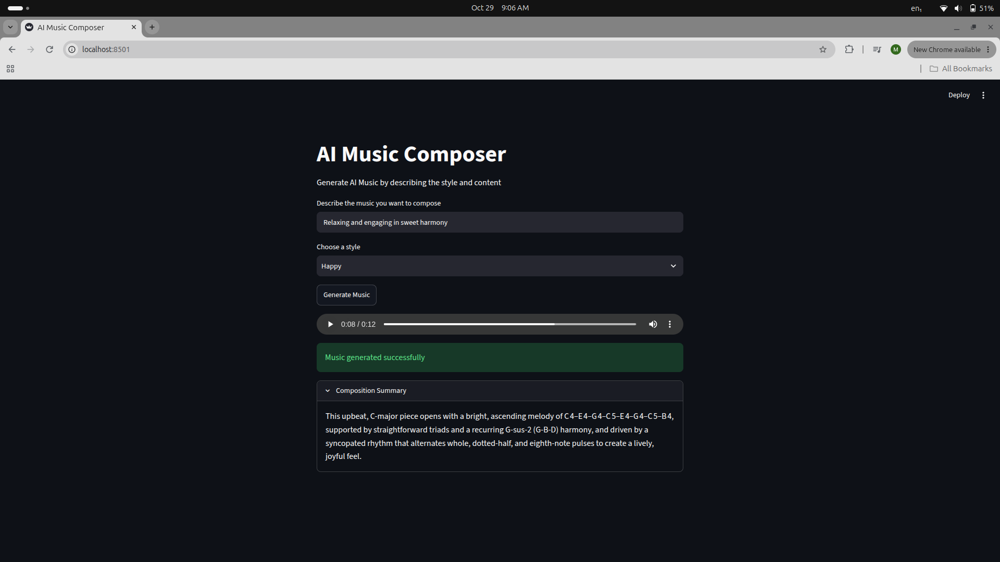

# AI Music Composer

AI Music Composer is a small Streamlit application that turns a text description
and a selected mood/style into a short musical sketch. It uses a Groq-hosted
language model to generate a melody, harmony, rhythm, and a composition summary,
then converts the generated notes into a playable WAV audio clip.



## What it does

1. Enter a description of the music you want, such as “relaxing music for a
   quiet evening.”
2. Select a style: **Sad**, **Happy**, **Jazz**, **Romantic**, or **Extreme**.
3. Select **Generate Music**. The app asks the language model for a melody,
   supporting chords, and rhythmic durations guided by the selected style.
4. Listen to the generated clip in the audio player and open **Composition
   Summary** to read a brief description of the result.

The generated piece is a lightweight musical sketch rather than a full
orchestration: note frequencies are rendered as sequential sine-wave tones.
Rhythm changes the duration of those tones. This keeps the application simple
and makes it easy to experiment with prompt-driven musical ideas.

## Generation flow

The main Streamlit interface is in `app.py`. The generation and rendering flow
is:

1. **Collect the request** — The user supplies a free-text description and
   chooses a style.
2. **Generate the melody** — `MusicLLM.generate_melody` prompts the Groq model
   for an eight-note, space-separated melody. The style-specific guidance
   encourages different musical contours and motifs.
3. **Generate harmony** — `MusicLLM.generate_harmony` asks for eight chords
   that support the melody and match the selected style.
4. **Generate rhythm** — `MusicLLM.generate_rhythm` asks for eight beat
   durations. These values are used to vary the length of the synthesized
   tones.
5. **Summarize the composition** — `MusicLLM.adapt_style` creates the text
   displayed in the **Composition Summary** expander.
6. **Convert notes to sound** — `app/uitls.py` uses `music21` to convert valid
   note names into frequencies. The melody and chord notes are combined into a
   sequence, synthesized as sine waves, and written to an in-memory WAV file
   with NumPy and SciPy.
7. **Play the result** — Streamlit serves the WAV bytes in its audio player.

The language-model prompts and Groq client are implemented in `app/main.py`.
The audio and pitch conversion helpers are in `app/uitls.py` (the module name
is intentionally spelled `uitls` in the current project).

## Technology

- Python 3.14 or newer
- [Streamlit](https://streamlit.io/) for the web interface
- [LangChain](https://www.langchain.com/) and `langchain-groq` for model prompts
  and inference
- Groq API with the `openai/gpt-oss-20b` model
- `music21`, `numpy`, `scipy`, and `synthesizer` for pitch conversion and WAV
  generation
- [uv](https://docs.astral.sh/uv/) for dependency management

## Requirements

- Python **3.14+**
- `uv`
- A Groq API key with access to the configured model

## Run locally

1. Clone the repository and enter the project directory:

   ```bash
   git clone https://github.com/maskedwolf4/AI-_Music_Composer
   cd AI-_Music_Composer
   ```

2. Install `uv` if it is not already available. See the
   [uv installation guide](https://docs.astral.sh/uv/getting-started/installation/).

3. Create a `.env` file in the project root and add your API key:

   ```dotenv
   GROQ_API_KEY=your_groq_api_key
   ```

   Keep this key private. `.env` is ignored by Git and should not be committed.

4. Install the locked dependencies without installing the project as a package
   (the application is run directly from `app.py`):

   ```bash
   uv sync --locked --no-install-project
   ```

5. Start the Streamlit app:

   ```bash
   uv run --no-sync streamlit run app.py
   ```

6. Open the local URL printed by Streamlit (by default,
   `http://localhost:8501`).

## Run with Docker

The Dockerfile uses Python 3.14 and installs dependencies with `uv` from
`pyproject.toml` and `uv.lock`.

Build the image from the repository root:

```bash
docker build -t ai-music-composer:latest .
```

Run the app and pass the Groq API key into the container:

```bash
docker run --rm \
  -p 8501:8501 \
  -e GROQ_API_KEY="$GROQ_API_KEY" \
  ai-music-composer:latest
```

Then open `http://localhost:8501`. For production deployments, provide the API
key through your platform's secrets facility rather than baking it into the
image.

## Deploy to Google Cloud Platform (GCP)

The project is configured for deployment to **Google Kubernetes Engine
(GKE)**. The GitLab pipeline builds a Docker image, pushes it to **Google
Artifact Registry**, and then applies a Kubernetes Deployment and Service.

The deployment settings currently declared in `.gitlab-ci.yml` are:

| Setting | Configured value |
| --- | --- |
| GCP project ID | `gen-lang-client-0827529680` |
| Region | `us-central1` |
| Artifact Registry host | `us-central1-docker.pkg.dev` |
| Artifact Registry repository | `llmops-repo` |
| GKE cluster | `llmops` |
| Image name and tag | `llmops-app:latest` |

These are project-specific values. Update the pipeline variables and
Kubernetes manifest image if deploying to a different GCP project, region,
registry, or cluster.

### GCP prerequisites

Before running the pipeline, ensure that:

- The Artifact Registry Docker repository `llmops-repo` exists in
  `us-central1`.
- The GKE cluster named `llmops` exists in `us-central1` in the configured
  project.
- The Google service account used by GitLab can push images to the Artifact
  Registry repository and retrieve GKE cluster credentials and deploy
  Kubernetes resources to the target cluster.
- GitLab runners support Docker-in-Docker for the image build job.

### Configure GitLab CI/CD variables

In the GitLab project, add a protected and masked CI/CD variable named
`GCP_SA_KEY`. Its value must be the **base64-encoded contents of the Google
Cloud service-account JSON key file**. The pipeline decodes it into a temporary
`gcp-key.json`, activates the service-account identity with `gcloud`, and
configures Docker authentication for Artifact Registry. Do not commit the key
file or print its contents in job logs.

The pipeline uses project, registry, region, repository, and cluster values
declared directly in `.gitlab-ci.yml`. If your environment differs, update
those values there and keep the image path synchronized with the Kubernetes
manifest.

### GitLab pipeline stages

The `.gitlab-ci.yml` pipeline declares three stages:

1. **Checkout** — GitLab checks out the source; the job currently only prints
   a confirmation message.
2. **Build** — Authenticates to GCP, builds the Docker image, and pushes
   `us-central1-docker.pkg.dev/gen-lang-client-0827529680/llmops-repo/llmops-app:latest`
   to Artifact Registry.
3. **Deploy** — Retrieves credentials for the `llmops` GKE cluster and applies
   the Kubernetes manifest with `kubectl`.

The deployment manifest defines a one-replica Deployment and a
`LoadBalancer` Service. The Service exposes port 80 and forwards requests to
Streamlit on container port 8501. The manifest's image path currently matches
the image path built by the pipeline.

### Deployment filename mismatch to fix

There is currently a filename mismatch between the pipeline and the repository:
the deploy job runs:

```bash
kubectl apply -f kubernetes-deployment.yaml
```

but the checked-in file is named `kubernetes-dployment.yaml` (missing the
second “e” in “deployment”). As a result, the GitLab deploy job will fail to
find the manifest unless the filename is made consistent. Either rename the
manifest to `kubernetes-deployment.yaml` or change the `kubectl apply` path in
`.gitlab-ci.yml` to `kubernetes-dployment.yaml`.

### Provide the Groq API key to GKE

The Kubernetes Deployment reads `GROQ_API_KEY` from a Secret named
`llmops-secrets`. The GitLab pipeline does **not** create this Secret, so it
must already exist in the target namespace before the app starts. For a
namespace using a protected local `.env` file:

```bash
kubectl create secret generic llmops-secrets --from-env-file=.env
```

Run this against the correct GKE cluster and namespace. Do not commit `.env` or
expose the key in logs. For production, consider synchronizing the key from
Google Secret Manager rather than managing it manually.

### Check the deployment

After the GitLab pipeline completes, check the Kubernetes resources:

```bash
kubectl get deployments,pods,services
```

When the external load balancer has been provisioned, the service's
`EXTERNAL-IP` can be read with:

```bash
kubectl get service llmops-service
```

Open that address in a browser. Load-balancer provisioning can take a few
minutes. If the Deployment does not become ready, inspect its pods and events:

```bash
kubectl get pods
kubectl describe deployment llmops-app
```

## Project layout

```text
.
├── app.py                    # Streamlit interface and application flow
├── app/
│   ├── main.py               # Groq / LangChain music generation prompts
│   └── uitls.py              # Note conversion and WAV synthesis helpers
├── assets/
│   └── AIMusicDemo.png       # Application screenshot
├── Dockerfile                # Container image definition using uv
├── .gitlab-ci.yml            # GitLab pipeline for Artifact Registry and GKE
├── kubernetes-dployment.yaml # Kubernetes Deployment and Service
├── pyproject.toml            # Project metadata and dependencies
└── uv.lock                   # Locked dependency versions
```

## Configuration and troubleshooting

- **Missing API key:** Confirm `GROQ_API_KEY` is set in `.env` for local runs,
  or available to the container as an environment variable / Kubernetes
  Secret.
- **Model or API errors:** Check that the key is valid and that the configured
  Groq model is available to your account.
- **Dependency lock mismatch:** Run `uv lock` after intentionally changing
  dependencies, then install with `uv sync --locked`.
- **GitLab deployment cannot find the manifest:** Resolve the filename
  mismatch between the `.gitlab-ci.yml` apply command and the checked-in
  `kubernetes-dployment.yaml` file.
- **Kubernetes image pull errors:** Verify the manifest's `image` path matches
  the pushed Artifact Registry image and that the GKE nodes can pull it.
- **Kubernetes pod cannot start due to missing configuration:** Verify the
  `llmops-secrets` Secret exists in the same namespace as the Deployment and
  contains a `GROQ_API_KEY` key.
- **Service has no external address yet:** Wait for the cloud load balancer to
  be provisioned and check the Service status with `kubectl get service`.

## Security

Never commit API keys, `.env` files, registry credentials, or Kubernetes Secret
values to the repository. Use environment variables for local/container runs
and a secrets manager or Kubernetes Secret for cluster deployments.
